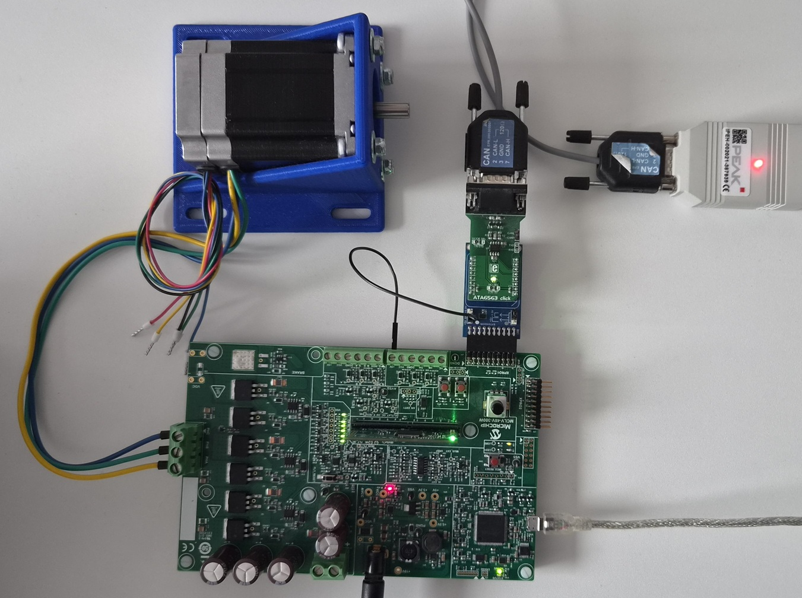
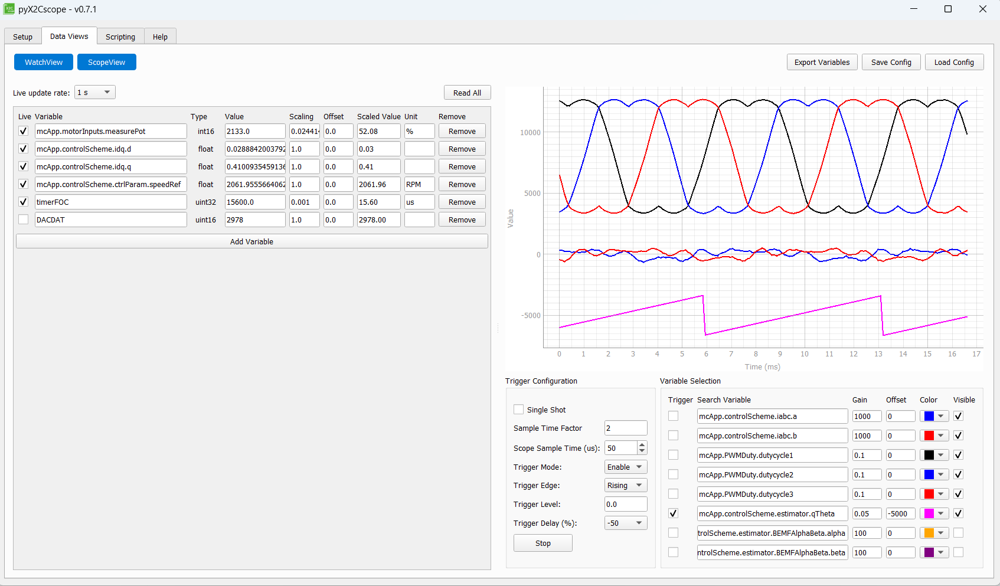

# dsPIC33AK512MC510 Sensorless FOC with X2Cscope over CAN

**Sensorless Field-Oriented Control (FOC) of a BLDC/PMSM motor on the MCLV-48V-300W board with real-time monitoring via X2Cscope over CAN (classic CAN 2.0, 500 kbit/s).**

[](#license)


---





---

## Table of Contents

- [About](#about)
- [Features](#features)
- [Hardware Requirements](#hardware-requirements)
- [Hardware Setup](#hardware-setup)
- [Software Requirements](#software-requirements)
- [Project Structure](#project-structure)
- [Architecture](#architecture)
- [Configuration](#configuration)
- [MCC Configuration](#mcc-configuration)
- [Building and Programming](#building-and-programming)
- [Running the Demo](#running-the-demo)
- [X2Cscope Usage](#x2cscope-usage)
- [Overcurrent Protection](#overcurrent-protection)
- [X2Cscope CAN Transport](#x2cscope-can-transport)
- [License](#license)
- [Contact](#contact)

---

## About

This project implements **sensorless Field-Oriented Control (FOC)** of a 3-phase BLDC/PMSM motor on the **MCLV-48V-300W** evaluation board, using the **dsPIC33AK512MC510 DIM** module as the controller. The motor targeted by default is the **ACT 57BLF02** brushless DC motor.

The FOC algorithm uses a **back-EMF PLL estimator** for sensorless rotor position and speed estimation, enabling smooth sinusoidal commutation without Hall sensors or encoders. The control loop executes at 20 kHz with a measured execution time of **~15.6 µs**.

X2Cscope, a real-time software oscilloscope, communicates with the host PC over **CAN1** (classic CAN 2.0, 500 kbit/s, standard 11-bit identifiers). On the board side, an **ATA6563 click** CAN transceiver is attached to the XPRO1 header through an Xplained Pro extension. On the PC side, pyX2Cscope connects through a USB-CAN adapter (e.g. PCAN-USB).

CAN requires an accurate and stable clock, so the device runs from the **8 MHz MEMS oscillator (Y1)** on the DIM module instead of the internal FRC oscillator.

All peripheral driver code is generated by **MPLAB Code Configurator (MCC) Melody**. The FOC algorithm layer (`src/mc/`) is fully portable and hardware-independent — all hardware access is abstracted through `src/hal/mc/mc_hal.c`.

---

## Features

- **Sensorless FOC** — back-EMF PLL estimator for rotor position; Clarke/Park transforms, PI current controllers, Space Vector Modulation (SVM)
- **Startup sequence** — rotor lock → open-loop forced angle ramp → closed-loop transition with smooth RRF variable transfer
- **Speed control** — closed-loop PI speed controller with potentiometer reference and configurable ramp rates
- **Flux weakening** — feed-forward or voltage-feedback field weakening for extended speed range
- **20 kHz PWM** — three PWM generators (PG1/PG2/PG3) at 400 MHz PWM clock, 0.75 µs dead time, ~15.6 µs FOC execution time
- **Hardware overcurrent protection** — CMP3/DAC3 comparator with cycle-by-cycle PWM fault PCI (no software latency)
- **Software overcurrent detection** — per-cycle phase current magnitude check with configurable fault threshold
- **Smooth direction reversal** — FOC decelerates to zero speed under closed-loop control before restarting in the opposite direction
- **X2Cscope v3.0 over CAN** — real-time variable monitoring and modification from pyX2Cscope over CAN1 (500 kbit/s, Device->PC ID `0x100`, PC->Device ID `0x110`)
- **MCC Melody abstraction** — all peripheral drivers (ADC, PWM, CAN, OPA, CMP, UART, Timer) are MCC-generated
- **Portable FOC layer** — `src/mc/` contains zero hardware dependencies; porting to another board requires only reimplementing `src/hal/mc/mc_hal.c`
- **UART debug output** — startup banner and status messages on UART1

---

## Hardware Requirements

| Component | Details |
|-----------|---------|
| Evaluation Board | [MCLV-48V-300W Motor Control Low-Voltage Evaluation Board](https://www.microchip.com/en-us/development-tool/EV18H47A) |
| Controller Module | dsPIC33AK512MC510 DIM module |
| Motor | ACT 57BLF02 BLDC motor (default) |
| CAN Transceiver | [ATA6563 click](https://www.mikroe.com/ata6563-click) (MIKROE-2334) on an Xplained Pro extension, plugged into the XPRO1 header |
| CAN Adapter (PC) | USB-CAN adapter supported by pyX2Cscope (e.g. PCAN-USB) |
| CAN Bus | Cable with 120 Ω termination at both ends |
| Programmer/Debugger | MPLAB PKOB4 (on-board) or compatible ICD/PICkit |

**Motor Parameters** (defined in `src/mc/motor/act57blf02.h`):

| Parameter | Value |
|-----------|-------|
| Pole Pairs | 4 |
| Phase Resistance | 0.2672 Ohm |
| Phase Inductance | 135 µH |
| BEMF Constant | 6.57 mV/RPM (mechanical) |
| Nominal Speed | 3000 RPM |
| Maximum Speed | 3500 RPM |
| Rated Current | 7 A RMS |

---

## Hardware Setup


*MCLV-48V-300W with the dsPIC33AK512MC510 DIM, ACT 57BLF02 motor, ATA6563 click on the XPRO1 header and a PCAN-USB adapter on the PC side.*

### CAN Transceiver (ATA6563 click)

The ATA6563 click is connected to the XPRO1 header of the MCLV-48V-300W through an Xplained Pro extension. CAN1 is routed to the header via PPS:

| Signal | dsPIC33AK pin | Function |
|--------|---------------|----------|
| CAN1TX | RC11 (RP44) | MCU -> transceiver TXD |
| CAN1RX | RC10 (RP43) | Transceiver RXD -> MCU |

### 5 V Supply for the Click Board

The ATA6563 click needs both **3.3 V** (logic interface) and **5 V** (CAN transceiver supply), but the XPRO1 header only provides 3.3 V. To supply 5 V:

1. Take 5 V from the **5V pin on header J5** of the MCLV-48V-300W.
2. Connect it with a jumper wire to the **5V_EXT** pin of the Xplained Pro extension.

Without the 5 V supply the transceiver does not drive the bus and X2Cscope cannot connect.

### CAN Bus

- Connect the click board CAN connector to the USB-CAN adapter (CAN_H, CAN_L, GND).
- Terminate the bus with 120 Ω at both ends.

### Clock Source

Classic CAN needs a bit-time tolerance that the internal FRC oscillator cannot guarantee over temperature, so the device clock is derived from the **8 MHz MEMS oscillator (Y1)** on the DIM module, connected to **OSCI** and configured in MCC as **External Clock**. PLL1 multiplies it to the 200 MHz system clock, and Clock Generator 10 provides the 20 MHz CAN clock (see [mcc_config.md](mcc_config.md#clock-configuration)).

---

## Software Requirements

| Tool | Version |
|------|---------|
| MPLAB Extension for VS Code | Latest |
| XC-DSC Compiler | 3.31.01 |
| MPLAB Code Configurator (MCC) Melody | 5.7.0 (MCC Core 5.9.0, Melody Library 2.10.1) |
| X2Cscope Library | v3.0 |
| X2Cscope GUI (host) | pyX2Cscope >= 0.7.0 (CAN interface support) |
| Device Family Pack | dsPIC33AK-MC_DFP v1.4.172 |

---

## Project Structure

| Path | Purpose |
|------|---------|
| `src/` | Application source code |
| `src/main.c` | Entry point: system init, X2Cscope init, ADC ISR, main loop |
| `src/app.c/.h` | Button handling |
| `src/mc/` | **Portable FOC motor control** (no hardware dependencies) |
| `src/mc/mc_app.c/.h` | Motor control state machine (init, offset, run, stopping, fault) |
| `src/mc/mc_user_params.h` | Motor selection and board parameters |
| `src/mc/mc_calc_params.h` | Derived constants (PI gains, filter coefficients, timing) |
| `src/mc/foc/` | FOC algorithm: Clarke/Park, PI, SVM, PLL estimator, flux weakening |
| `src/mc/motor/` | Motor parameter header files |
| `src/mc/measure.c/.h` | Current offset calibration |
| `src/mc/fault.c/.h` | Software overcurrent detection |
| `src/hal/hal.c/.h` | Board HAL init (calls MCC `SYSTEM_Initialize()`) |
| `src/hal/mc/mc_hal.c/.h` | **Hardware abstraction for motor control** (ADC, PWM, CMP3 — MCC Melody implementation) |
| `src/X2Cscope/` | X2Cscope init and CAN transport layer (`X2CscopeComm.c`) |
| `src/systick/` | System tick counter (TMR1, 10 µs resolution) |
| `dsPIC33AK512MC510_MCLV48V300W_CAN/mcc_generated_files/` | MCC Melody generated peripheral drivers |
| `libs/` | Pre-built X2Cscope static library (`libx2cscope-generic-32dsp-dspic33a-elf.a`) |
| `out/AK512_FOC_CAN/` | Build output: `default.elf`, `default.hex` |

---

## Architecture

```
[MCLV-48V-300W Board]
  dsPIC33AK512MC510 @ 200 MHz FCY (8 MHz MEMS oscillator Y1 -> PLL1)
  |
  |-- PWM PG1/PG2/PG3 (20 kHz, 400 MHz clock) ---> 3-phase inverter (SVM)
  |-- ADC1/ADC2/ADC3 + OPA1/OPA2/OPA3 -----------> Ia, Ib, Vbus, Ibus, POT
  |-- CMP3/DAC3 (cycle-by-cycle OC) -------------> PWM Fault PCI (hardware protection)
  |-- GPIO RA12/RE1 -----------------------------> SW1/SW2 user buttons
  |-- GPIO LED1/LED2 ----------------------------> heartbeat / run state indicators
  |-- UART1 ------------------------------------> printf debug output (startup banner)
  |-- CAN1 (RC11 TX / RC10 RX) -----------------> XPRO1 header -> ATA6563 click -> CAN bus (500 kbit/s)
        |
        +-- X2Cscope LNet byte stream packed into 8-byte CAN frames
              Device -> PC : ID 0x100 (TXQ)
              PC -> Device : ID 0x110 (hardware filter 0 -> FIFO1 "X2CSCOPE_RX")
              |
              [USB-CAN adapter (e.g. PCAN-USB)] ---> Host PC running pyX2Cscope
```

### FOC Control Loop (20 kHz, ~15.6 µs execution)

```
ADC ISR (PWM-triggered at 20 kHz)
  |
  +-- MC_HAL_MotorInputsRead()    → Read Ia, Ib, Vbus, POT from ADC
  +-- MeasureCurrentCalibrate()   → Offset correction, Ic = -(Ia+Ib)
  +-- Clarke Transform            → Ialpha, Ibeta
  +-- Park Transform              → Id, Iq (using estimated theta)
  +-- PI Controller (Id)          → Vd
  +-- PI Controller (Iq)          → Vq
  +-- Inverse Park                → Valpha, Vbeta
  +-- Inverse Clarke              → Va, Vb, Vc
  +-- Space Vector Modulation     → duty1, duty2, duty3
  +-- MC_HAL_PWMDutySet()         → Write to PG1DC/PG2DC/PG3DC
  +-- Back-EMF PLL Estimator      → theta, omega (sensorless)
  +-- Speed PI Controller         → Iq reference (closed-loop)
  +-- X2Cscope_Update()           → Snapshot variables for scope
```

### Application State Machine

```
INIT → CMD_WAIT → OFFSET → LOAD_START_READY_CHECK → RUN → STOPPING → STOP → INIT
                                                      ↓
                                                    FAULT
```

### Execution Flow

1. **Initialization** — `HAL_Init()` calls MCC `SYSTEM_Initialize()` (includes `CAN1_Initialize()`), then `SysTick_Initialize()`, button init, UART banner
2. **Motor Control Init** — `MC_APP_Init()`: parameter config, PWM disable, CMP3/DAC3 overcurrent protection init
3. **X2Cscope Init** — `X2Cscope_Init()`: 5000-byte scope buffer, registers the CAN transport callbacks, programs CAN1 filter 0 with `X2CSCOPE_CAN_RX_ID`, resets the RX ring buffer and TX frame buffer
4. **Main loop** — `X2CscopeComm_Communicate()` (drains the `X2CSCOPE_RX` FIFO, then runs `X2Cscope_Communicate()`), button handling, direction change handling, LED updates
5. **ADC interrupt (20 kHz)** — FOC state machine → `X2Cscope_Update()`

The speed reference always comes from the potentiometer.

---

## Configuration

Motor and control parameters are defined in `src/mc/mc_user_params.h` and `src/mc/motor/act57blf02.h`.

### Key Parameters

| Parameter | Default | Description |
|-----------|---------|-------------|
| `NOMINAL_SPEED_RPM` | 3000 | Target operating speed |
| `MAXIMUM_SPEED_RPM` | 3500 | Speed limit |
| `MINIMUM_SPEED_RPM` | 500 | Minimum speed / open-loop transition speed |
| `OPEN_LOOP_CURRENT` | 1.0 A | Forced current during open-loop startup |
| `LOCK_TIME_SEC` | 0.75 s | Rotor alignment duration |
| `OC_FAULT_LIMIT_PHASE` | 20.0 A | Software overcurrent threshold (phase) |
| `OC_FAULT_LIMIT_DCBUS` | 10.0 A | Hardware overcurrent threshold (CMP3/DAC3) |
| `FLUX_WEAKENING_VARIANT` | 2 | 0=off, 1=PI voltage feedback, 2=feed-forward |

### CAN Parameters

The CAN IDs are defined in `src/X2Cscope/X2CscopeComm.c`, which is the single source of truth. Bit rate, FIFOs and the filter-to-FIFO routing are configured in MCC (`mcc_generated_files/can/src/can1.c`):

| Parameter | Value |
|-----------|-------|
| Protocol | Classic CAN 2.0, standard 11-bit IDs, no BRS |
| Bit rate | 500 kbit/s (FCAN 20 MHz, 40 TQ, sample point 80%) |
| Device -> PC ID (`X2CSCOPE_CAN_TX_ID`) | `0x100` (sent via TXQ) |
| PC -> Device ID (`X2CSCOPE_CAN_RX_ID`) | `0x110` (hardware filter 0, exact match, into FIFO1 `X2CSCOPE_RX`) |
| TXQ depth | 1 message |
| RX FIFO1 (`X2CSCOPE_RX`) depth | 8 messages |
| Software RX ring buffer | 128 bytes |

MCC requirements checked or enforced by the firmware:

- **RX FIFO custom name `X2CSCOPE_RX`** — checked at compile time; the build fails with an `#error` if MCC does not provide it.
- **Filter 0** — reserved for X2Cscope. Its ID and mask are overwritten at startup by `X2CscopeComm_PostInit()` from `X2CSCOPE_CAN_RX_ID`, so the ID entered in MCC is only active until `X2Cscope_Init()`. To change the ID, edit `X2CSCOPE_CAN_RX_ID` only.
- **IDs** — `X2CSCOPE_CAN_TX_ID` and `X2CSCOPE_CAN_RX_ID` must be standard 11-bit IDs (checked at compile time).

---

## MCC Configuration

All peripherals are configured using **MPLAB Code Configurator (MCC) Melody**. The MCC project file is located at `dsPIC33AK512MC510_MCLV48V300W_CAN/mcc/dspic33ak512_can.mc3`. Generated driver source files are in `dsPIC33AK512MC510_MCLV48V300W_CAN/mcc_generated_files/` and should never be edited manually — regenerate from MCC instead.

Configured peripherals include: PWM (PG1/PG2/PG3), ADC (ADC1/ADC2/ADC3), OPA (OPA1/OPA2/OPA3), CMP3/DAC3, CAN1, UART1, TMR1, and SCCP1. The system clock is derived from the external 8 MHz MEMS oscillator (Y1) through PLL1.

For detailed MCC screenshots and per-peripheral configuration, see [mcc_config.md](mcc_config.md).

---

## Building and Programming

This project uses the **MPLAB Extension for VS Code** with a CMake/Ninja build system generated by MCC.

### Build

1. Open the workspace folder in VS Code with the MPLAB extension installed.
2. Select the **default** build configuration of project `AK512_FOC_CAN`.
3. Run the build task (`Ctrl+Shift+B` → `Build`), or use the MPLAB build button in the activity bar.

The compiled output is placed in `out/AK512_FOC_CAN/default.hex` (ELF: `out/AK512_FOC_CAN/default.elf`).

### Program

Connect the MCLV-48V-300W board via USB (PKOB4 on-board debugger).

Use the MPLAB extension **Program Device** action, or launch the debugger with `F5` using the provided `launch.json` configuration.

### Build Settings

| Setting | Value |
|---------|-------|
| Device | `dsPIC33AK512MC510` |
| Compiler | XC-DSC v3.31.01 |
| Optimization | `-O3` |
| Include Paths | `src/`, `src/hal/`, `src/mc/`, `dsPIC33AK512MC510_MCLV48V300W_CAN/` |
| Linked Library | `libs/libx2cscope-generic-32dsp-dspic33a-elf.a` |

---

## Running the Demo

1. Connect the ACT 57BLF02 motor phase wires to the MCLV-48V-300W board (no Hall sensors needed for FOC).
2. Connect the ATA6563 click (with the 5 V jumper wire, see [Hardware Setup](#hardware-setup)) to the USB-CAN adapter (bus terminated with 120 Ω at both ends).
3. Power the board and program the firmware.
4. **Start motor** — press SW1. LED2 illuminates when the motor is running.
5. **Adjust speed** — turn the potentiometer to set the speed reference (500–3500 RPM).
6. **Reverse direction** — press SW2. The motor decelerates smoothly to zero, then restarts in the opposite direction.
7. **Stop motor** — press SW1 again. The motor decelerates to zero under closed-loop control before PWM is disabled.
8. **LED1** blinks at 2 Hz as a heartbeat indicator.

### Startup Sequence

When SW1 is pressed, the FOC executes the following startup:
1. **Rotor Lock** (0.75 s) — a fixed d-axis voltage aligns the rotor to a known position
2. **Open Loop** — forced angle ramp accelerates the motor to minimum speed (500 RPM) with fixed current
3. **Closed Loop Transition** — once the PLL estimator converges, the FOC switches to sensorless closed-loop speed control

---

## X2Cscope Usage

X2Cscope provides a real-time software oscilloscope view of internal firmware variables without halting the CPU.


*pyX2Cscope showing phase currents (Ia, Ib), SVM duty cycles, estimated rotor angle (theta), and watch variables (Id, Iq, speed reference, FOC execution time, DACDAT overcurrent threshold).*

### Installation

If pyX2Cscope is not installed, run the provided script to get the latest version (version 0.7.0 or newer is required for CAN):

```bash
get_pyx2cscope.bat
```

### Connecting

1. Connect the USB-CAN adapter (e.g. PCAN-USB) to the host PC and to the CAN bus.
2. Launch pyX2Cscope on the host PC.
3. Select **CAN** as the interface, choose the USB-CAN adapter, and set:
   - Bitrate: **500 kbit/s**
   - TX ID (PC -> Device): **`0x110`**
   - RX ID (Device -> PC): **`0x100`**
4. Load the firmware ELF file (`out/AK512_FOC_CAN/default.elf`) to resolve variable symbols.
5. Connect and go to **Data Views**, then press **Load Config** to load `pyX2Cscope_config.json` from this repository. It will load the default scope and watch variables.
6. Use the oscilloscope and watch views to monitor FOC variables in real time.

### Scope View Channels

| Variable | Color | Description |
|----------|-------|-------------|
| `mcApp.controlScheme.iabc.a` | Blue | Phase A current |
| `mcApp.controlScheme.iabc.b` | Red | Phase B current |
| `mcApp.PWMDuty.dutycycle1` | Black | SVM duty cycle 1 |
| `mcApp.PWMDuty.dutycycle2` | Blue | SVM duty cycle 2 |
| `mcApp.PWMDuty.dutycycle3` | Red | SVM duty cycle 3 |
| `mcApp.controlScheme.estimator.qTheta` | Magenta | Estimated electrical angle (trigger source) |

### Watch View Variables

| Variable | Type | Scaling | Unit | Description |
|----------|------|---------|------|-------------|
| `mcApp.motorInputs.measurePot` | int16 | 0.0244 | % | Potentiometer position |
| `mcApp.controlScheme.idq.d` | float | 1.0 | A | Measured d-axis current |
| `mcApp.controlScheme.idq.q` | float | 1.0 | A | Measured q-axis current |
| `mcApp.controlScheme.ctrlParam.speedRef` | float | 1.0 | RPM | Speed reference |
| `timerFOC` | uint32 | 0.001 | µs | FOC loop execution time (~15.6 µs) |
| `DACDAT` (SFR) | uint16 | 1.0 | counts | CMP3 overcurrent DAC threshold |

---

## Overcurrent Protection

The project implements two layers of overcurrent protection:

### Hardware Protection (CMP3 + PWM Fault PCI)

This is the primary protection layer with **zero software latency**. It operates entirely in hardware:

- **Comparator 3 (CMP3)** monitors the DC bus current via OPA3 output (CMP3A / RA5)
- **DAC3** provides a programmable threshold reference (default: 2900 counts, valid range: 0–3890). The threshold can be adjusted at runtime via X2Cscope by writing `DAC3DATbits.DACDAT`
- When bus current exceeds the threshold, CMP3 output triggers the **PWM Fault PCI** on all three generators
- **Cycle-by-cycle mode**: PWM outputs are forced LOW for the remainder of the current PWM cycle only. On the next cycle, if the current has dropped below the threshold, normal operation resumes automatically
- No software intervention required — the FOC continues running while hardware silently clips overcurrent pulses

### Software Protection (fault.c)

A secondary layer that catches sustained overcurrent conditions:

- Each FOC cycle, the phase current magnitudes are checked against `OC_FAULT_LIMIT_PHASE` (20 A default)
- If any phase exceeds the limit, the application transitions to `MCAPP_FAULT` state and PWM is disabled
- Recovery requires a power cycle or debugger reset

### Stall Detection and Recovery

When the overcurrent threshold is set low enough that the motor cannot develop sufficient torque, or when the rotor is mechanically blocked, the sensorless estimator loses angle tracking. Without countermeasures, the FOC would apply torque in random directions causing severe vibration.

The firmware implements automatic stall detection and recovery:

1. **Closed-loop stall detection** — If the estimated speed drops below 200 RPM while the target speed is above 200 RPM for longer than 200 ms, the FOC declares a stall and restarts from rotor lock
2. **Open-loop timeout** — If the open-loop startup phase does not achieve closed-loop transition within 1.0 s, the FOC restarts from rotor lock
3. **Automatic retry** — The lock → open-loop → closed-loop sequence repeats until conditions allow the motor to spin (e.g., overcurrent threshold raised, mechanical blockage removed)

During the rotor lock phase, d-axis voltage holds the rotor at a known position without vibration. During open-loop, a forced angle drives the motor at a deterministic rate. The retry loop ensures the motor resumes as soon as the constraint is lifted.

Stall parameters are defined in `src/mc/motor/act57blf02.h`:

| Parameter | Default | Description |
|-----------|---------|-------------|
| `STALL_SPEED_THRESHOLD_RPM` | 200 RPM | Speed below which the motor is considered stalled |
| `STALL_DETECT_TIME_SEC` | 0.200 s | Time before declaring stall in closed-loop |
| `OL_TIMEOUT_SEC` | 1.000 s | Maximum time in open-loop before retry |

### Testing Overcurrent via pyX2Cscope

To verify the hardware overcurrent protection is functioning:

1. Connect to the board via pyX2Cscope (CAN, 500 kbit/s, TX ID `0x110`, RX ID `0x100`)
2. Start the motor (press SW1)
3. Add the SFR `DAC3DATbits.DACDAT` to the watch view (this is the overcurrent threshold in DAC counts)
4. The default value is **2900** (configured in MCC). The DAC valid range is **0–3890** (0x000–0xF32)
5. **Gradually lower** the value (e.g., to 2200, then 2100, etc.)
6. Observe the phase currents (`mcApp.motorInputs.measureCurrent.Ia_actual`) — as the threshold approaches the actual bus current, the waveforms will begin to show clipping
7. At sufficiently low thresholds, the motor will stall as all PWM pulses are truncated. The stall recovery mechanism will automatically retry the startup sequence
8. **Restore** the original value (2900) — the motor will resume spinning on the next retry cycle
9. To effectively **disable** overcurrent protection, set `DACDAT` to 3890 (maximum). The threshold becomes unreachable and cycle-by-cycle limiting stops

> **Note:** The DAC reference formula is: `DACDAT = (I_limit * 2048 / 22.0) + 2048`, where 22.0 A is the full-scale current range and 2048 is the mid-scale offset. The hardware maximum is 3890 counts (0xF32).

---

## X2Cscope CAN Transport

The transport layer is implemented in `src/X2Cscope/X2CscopeComm.c`, based on the X2Cscope library `interface/examples/can` example, using the MCC Melody CAN1 driver.

X2Cscope uses a byte-stream protocol (LNet), while a classic CAN frame carries at most 8 data bytes:

- **TX** — `sendSerial()` collects outgoing bytes and transmits a full 8-byte frame (ID `0x100`, standard ID, classic CAN, no BRS) via the CAN1 TXQ every 8 bytes. `flushSerial()` sends the remaining 1–7 bytes as a shorter frame at the end of each LNet frame. `isSendReady()` reports whether the TXQ can accept a new frame.
- **RX filtering** — done in hardware. `X2CscopeComm_PostInit()` programs CAN1 filter 0 (exact 11-bit match on `X2CSCOPE_CAN_RX_ID`, standard IDs only) to route into the `X2CSCOPE_RX` FIFO. Frames with any other ID are dropped by the CAN module, so no software ID check is needed.
- **RX** — `X2CscopeComm_Communicate()` is called from the main loop instead of `X2Cscope_Communicate()`. It reads frames from `X2CSCOPE_RX` into a 128-byte software ring buffer (only while at least 8 bytes are free, so no received bytes are dropped; remaining frames stay in the hardware FIFO), then calls `X2Cscope_Communicate()`. `receiveSerial()` and `isReceiveDataAvailable()` read from the ring buffer.
- **Sampling** — `X2Cscope_Update()` is still called at the end of `ADC2_ChannelCallback()` at 20 kHz.

---

## License

Copyright (c) Microchip Technology Inc. All rights reserved.

Licensed under the **Apache License, Version 2.0**. See [LICENSE](LICENSE) for details.

---

## Contact

- **Team:** Motor Control Applications
- **Internal Wiki:** [Confluence - Motor Control](https://confluence.microchip.com)
- **Issue Tracker:** [Jira](https://jira.microchip.com)
