# MCC Melody Peripheral Configuration

All peripherals are configured using **MPLAB Code Configurator (MCC) Melody**. The MCC project file is located at `dsPIC33AK512MC510_MCLV48V300W_CAN/mcc/dspic33ak512_can.mc3`. Generated driver source files are in `dsPIC33AK512MC510_MCLV48V300W_CAN/mcc_generated_files/` and should never be edited manually — regenerate from MCC instead.

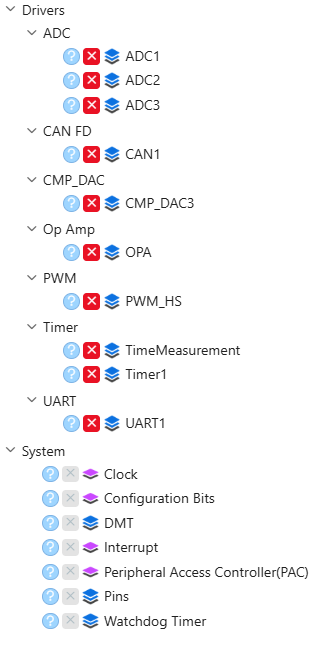

## Motor Control Peripherals

### Pin Manager

Pin assignments for motor control signals, Hall sensor inputs (RD4/RD5/RD6 — configured but not used by the sensorless FOC), user buttons (SW1 = RA12, SW2 = RE1), LEDs, and communication interfaces (CAN1, UART1). CAN1 uses PPS: CAN1TX on RC11 (RP44), CAN1RX on RC10 (RP43).

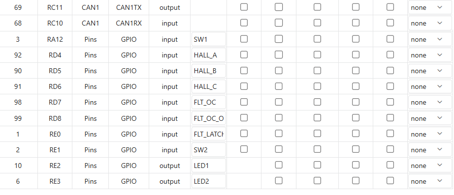

### PWM (PG1 / PG2 / PG3)

Three PWM generators in center-aligned complementary mode at 20 kHz (400 MHz PWM clock). Dead time: 0.75 µs. Master period set by PG1. All generators use independent duty cycle registers (PG1DC, PG2DC, PG3DC). Generator 1 additionally generates trigger signals to the ADCs. Generators 2 and 3 are configured identically to Generator 1 (parts 1 and 2) without the ADC trigger output.

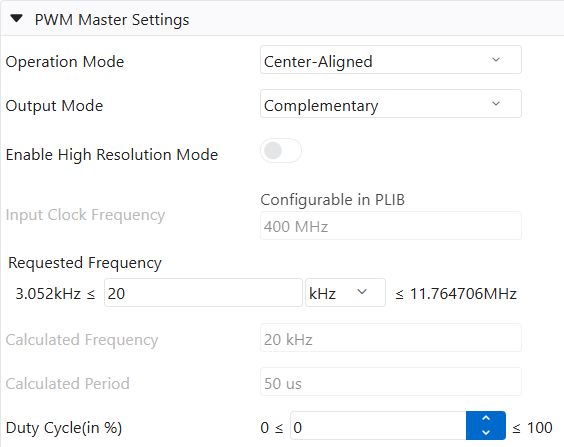

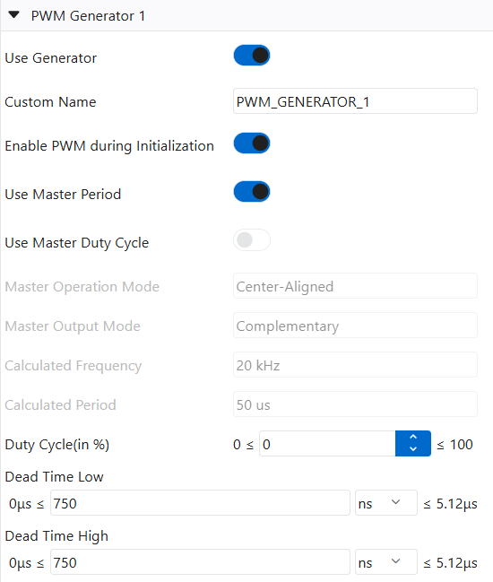

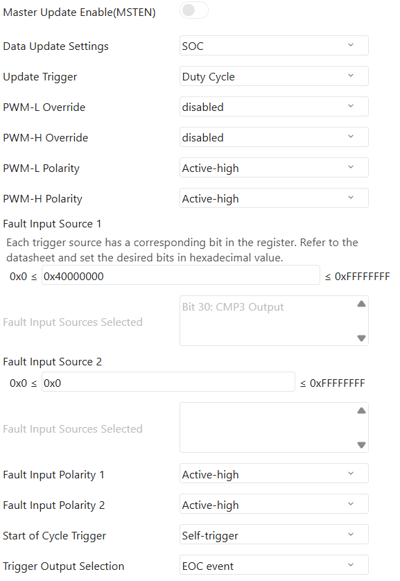

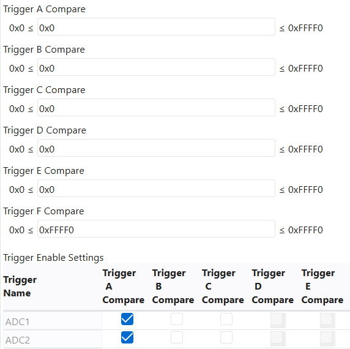

### ADC1 / ADC2 / ADC3

All ADC modules use **Clock Generator 6** as their clock source.

- **ADC1** — Phase A current (Ia) via OPA1 output
- **ADC2** — Phase B current (Ib) via OPA2 output, potentiometer (speed reference). PWM trigger drives 20 kHz sampling
- **ADC3** — DC bus current (Ibus) via OPA3 output, DC bus voltage (Vbus)

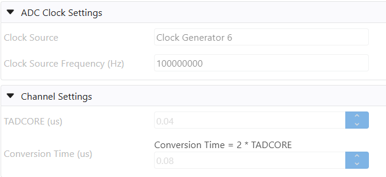

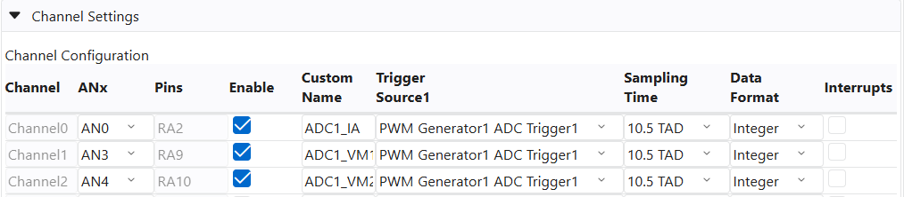

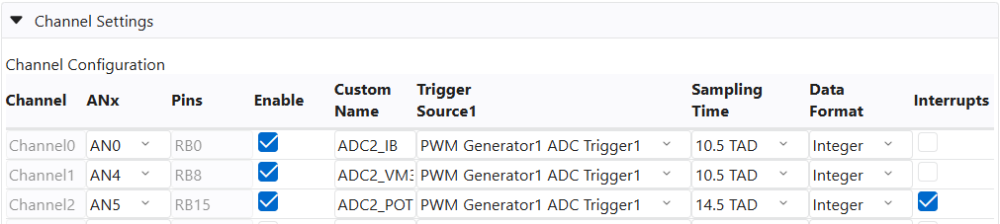

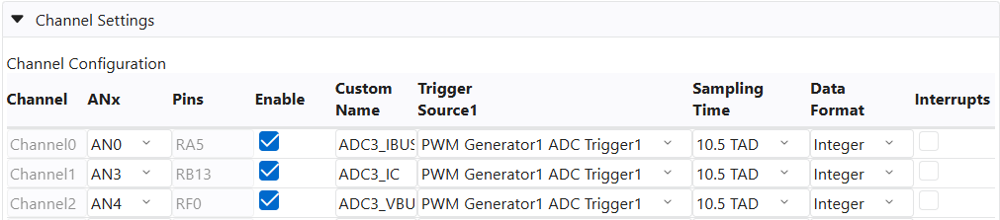

### CMP3 / DAC3

Comparator 3 monitors the DC bus current (CMP3A input) against a DAC3 reference for hardware overcurrent protection. DAC3 default value: 2900 counts (valid range: 0–3890 / 0x000–0xF32). Comparator blanking is enabled (CBE) with 45 mV hysteresis. Leading-edge blanking (TMCB = 500 ns) is configured in firmware post-init.

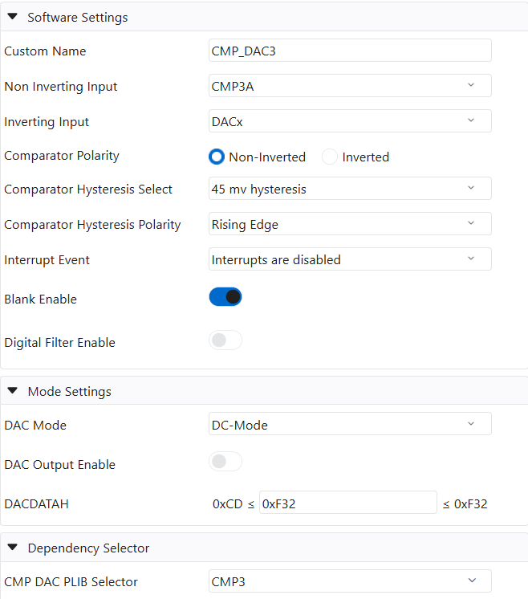

### OPA (OPA1 / OPA2 / OPA3)

On-chip operational amplifiers configured for current sense signal conditioning. The screenshot shows OPA1; **OPA2 and OPA3 are configured identically**. OPA1 and OPA2 amplify phase current shunt signals for ADC1 and ADC2. OPA3 amplifies the DC bus current shunt signal for ADC3 and CMP3.

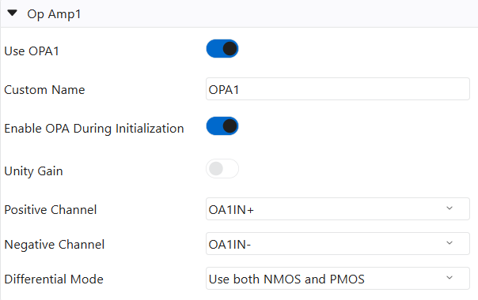

## System and Communication Peripherals

### Clock Configuration

System clock: 200 MHz FCY. Peripheral clock: 200 MHz (Fp). PWM clock: 400 MHz. CAN clock: 20 MHz.

#### External Clock Source

CAN requires an accurate and stable clock, which the internal FRC oscillator cannot guarantee. The dsPIC33AK512MC510 DIM module has an **8 MHz MEMS oscillator (Y1)** connected to **OSCI**, so the External Input Clock Source is set to **External Clock** at 8 MHz. Reference Input1 and Reference Input2 are also set to 8 MHz.

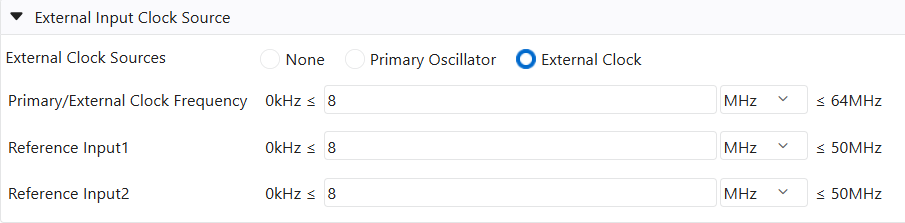

#### PLL1

PLL1 uses **Primary Oscillator/External Clock** (8 MHz) as its clock source. PLLPRE = 1 and PLLFBDIV = 200 give a 1600 MHz VCO; the VCO divider (INTDIV = 2) gives 400 MHz, and POSTDIV1 = 4 / POSTDIV2 = 2 give the 200 MHz PLL1 output.

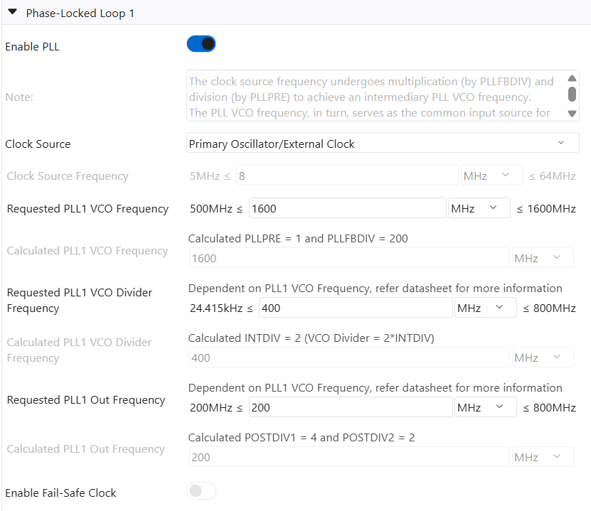

#### Clock Generators

The remaining clock generators are unchanged and derive from PLL1:

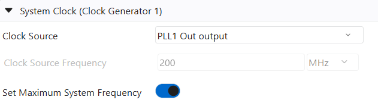

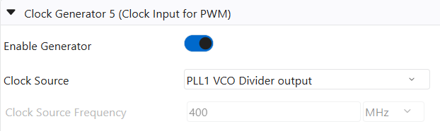

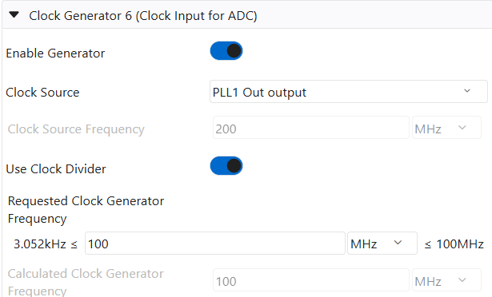

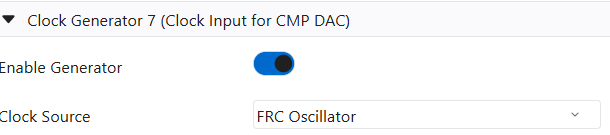

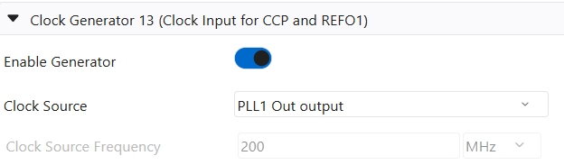

### CAN1

CAN1 carries the X2Cscope communication (see `src/X2Cscope/X2CscopeComm.c`). The CAN clock (FCAN) is 20 MHz from **Clock Generator 10**, which derives from PLL1 and therefore from the external 8 MHz MEMS oscillator.

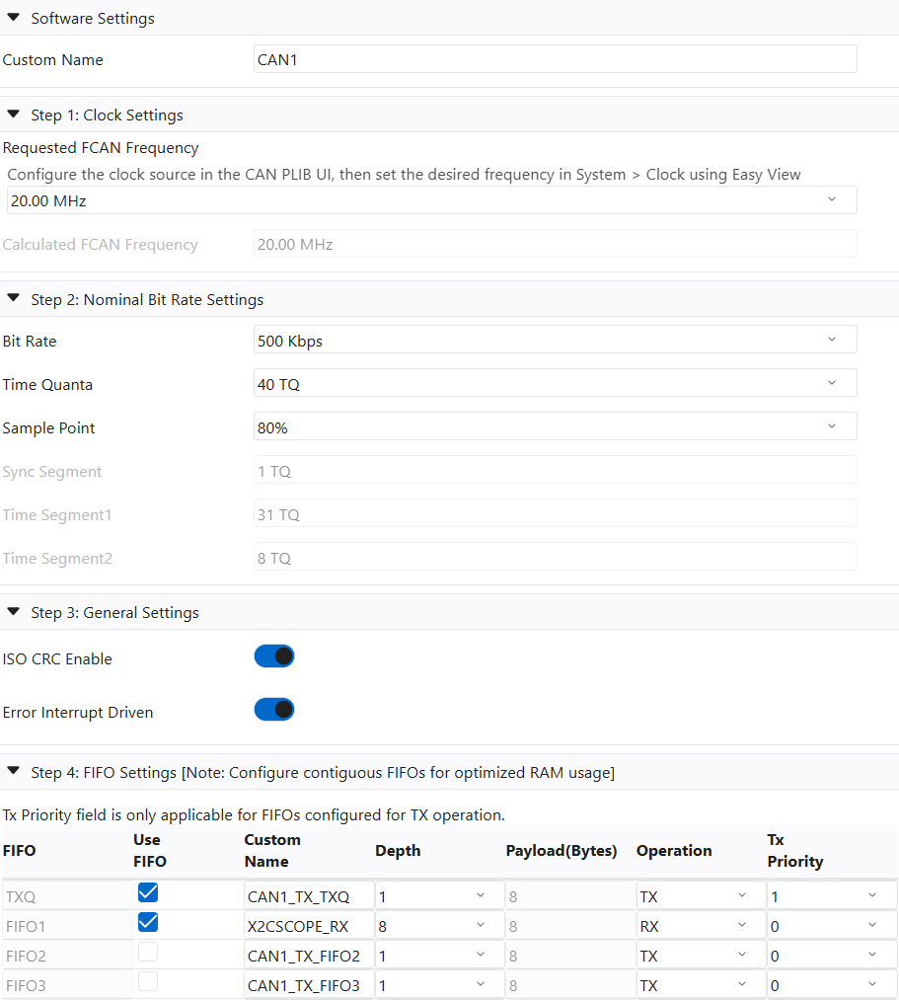

| Setting | Value |
|---------|-------|
| FCAN | 20 MHz (Clock Generator 10) |
| Nominal bit rate | 500 kbit/s, 40 TQ, sample point 80% (Sync 1 TQ, TSEG1 31 TQ, TSEG2 8 TQ) |
| Mode | Classic CAN 2.0, standard 11-bit IDs, no BRS, ISO CRC enabled, error interrupt driven |
| TXQ | Custom name `CAN1_TX_TXQ`, 1 message deep, 8-byte payload, TX priority 1 — Device -> PC frames (ID `0x100`) |
| FIFO1 | Custom name **`X2CSCOPE_RX`**, RX, 8 messages deep, 8-byte payload — PC -> Device frames (ID `0x110`) |
| FIFO2 / FIFO3 | Not used |
| Pins | CAN1TX = RC11 (RP44), CAN1RX = RC10 (RP43) via PPS |

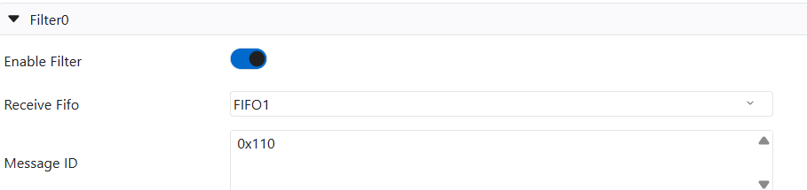

**Filter 0** is enabled and routed to FIFO1 with message ID `0x110`.

Notes on how the firmware uses this configuration:

- The FIFO custom name **must be `X2CSCOPE_RX`** — `X2CscopeComm.c` uses it directly and the build fails with an `#error` if it is missing.
- **Filter 0 is reserved for X2Cscope.** `X2CscopeComm_PostInit()` reprograms its ID and mask from `X2CSCOPE_CAN_RX_ID` (exact 11-bit match, standard IDs only) and routes it to `X2CSCOPE_RX`. The ID in MCC only applies until `X2Cscope_Init()` runs; `X2CSCOPE_CAN_RX_ID` is the single source of truth.
- Filtering is done in hardware: frames with other IDs never reach `X2CSCOPE_RX`. Frames are polled by `X2CscopeComm_Communicate()` in the main loop (no RX interrupt is used for data reception).

> Generated driver: `mcc_generated_files/can/src/can1.c`.

### UART1

UART1 provides printf debug output (startup banner and status messages). Used for development diagnostics only.

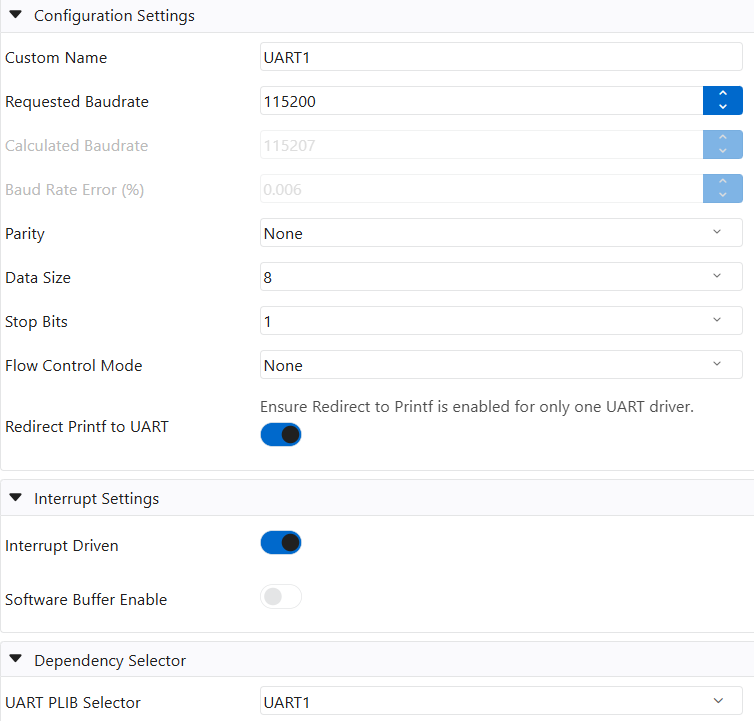

### Timers (TMR1 / SCCP1)

- **TMR1** — System tick timer (10 µs resolution) for non-real-time timing (LED heartbeat, button debounce)
- **SCCP1** — FOC execution time measurement timer. Started/stopped around the FOC ISR to measure loop time (~15.6 µs)

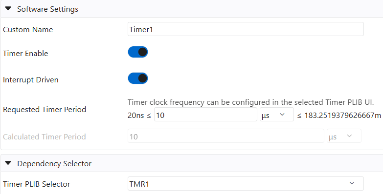

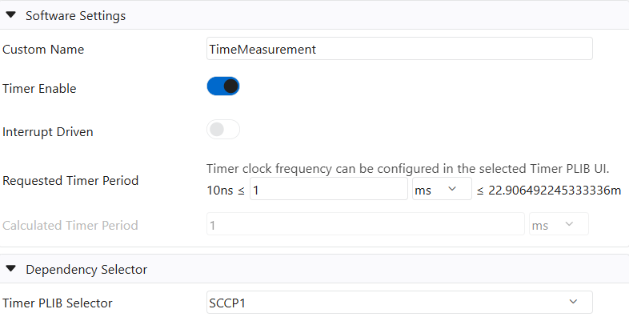
